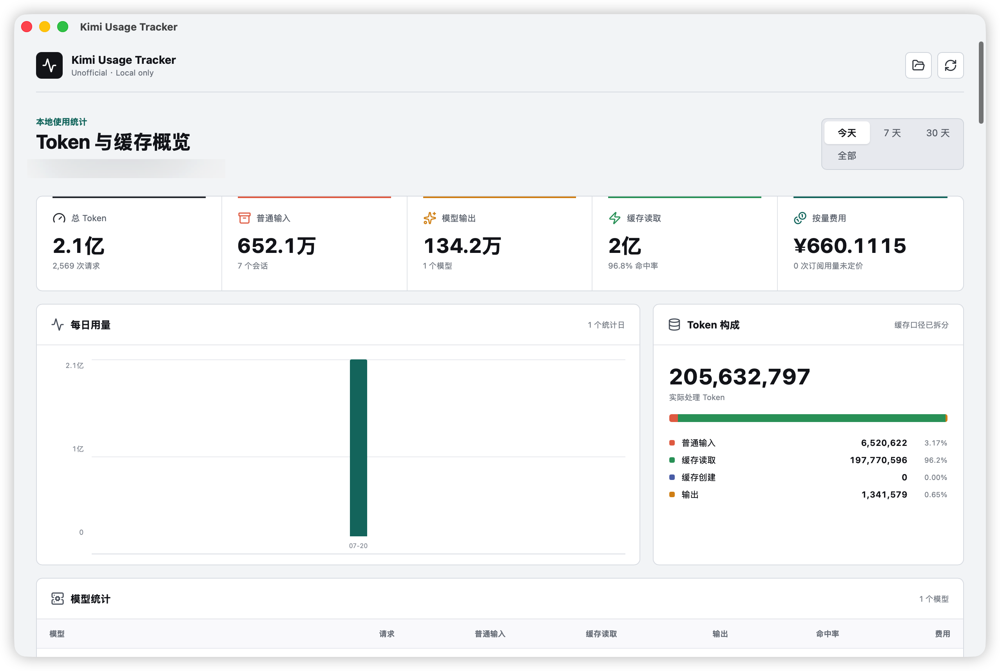

# Kimi Usage Tracker

[中文](#中文) · [English](#english)

An unofficial, local-only desktop dashboard for Kimi Code token, cache, model, and cost usage.

一款非官方、本地运行的 Kimi Code Token、缓存、模型与费用统计工具。



## 中文

Kimi Usage Tracker 读取 Kimi Code 已经写入本机的 `usage.record` 记录，并在本地生成统计结果。它不会代理请求、修改 Kimi 配置、读取对话正文或上传用量数据。

### 功能

- 统计普通输入、模型输出、缓存读取和缓存创建 Token
- 查看今天、7 天、30 天和全部用量
- 查看每日趋势、模型统计、缓存命中率和最近请求
- 按官方 Kimi API Platform 价格估算每条请求与模型费用
- 兼容 `config.toml` 模型别名、`KIMI_MODEL_NAME` 和 `__kimi_env_model__`
- 自动识别 `KIMI_CODE_HOME`、`~/.kimi-code` 和 Windows 用户目录，也可以手动选择其他数据目录

### macOS 使用

自动构建版本提供通用 macOS 镜像，同时支持 Apple Silicon 和 Intel Mac，要求 macOS 11 或更高版本。

1. 从 [Edge 自动构建版本](https://github.com/leolin-code/kimi-usage-tracker/releases/tag/edge) 下载 `Kimi-Usage-Tracker-macOS-universal.dmg`。
2. 打开 DMG，然后运行 `Kimi Usage Tracker.app`。
3. 程序会自动读取 `~/.kimi-code` 并显示统计结果。

当前应用使用临时签名，尚未经过 Apple 公证。如果 macOS 阻止首次启动，请按住 Control 点击应用，选择“打开”，然后确认一次。

如果 Kimi 数据不在默认目录，点击右上角的文件夹按钮选择对应目录。点击刷新按钮可以重新扫描数据。

### Windows

Windows 10/11 用户可以从 [Edge 自动构建版本](https://github.com/leolin-code/kimi-usage-tracker/releases/tag/edge) 直接下载 `Kimi-Usage-Tracker-Windows-x64.exe`，无需安装。也可以按照 [Windows 构建教程](docs/build-windows.md) 自行构建。

### 数据与隐私

默认扫描目录：

```text
macOS/Linux: ~/.kimi-code
Windows:     %USERPROFILE%\.kimi-code
```

工具只统计 `usage.record` 中的模型名、时间和 Token 数量。为了识别环境变量模型，它还会读取受限范围内的安全模型映射。提示词、回复正文、代码、API Key 和 Provider 凭据不会显示或记录。

所有扫描和计算都在本机完成。当前版本不会发起应用级网络请求。

### 费用说明

内置价格来自 Kimi API Platform 官方文档，单位为人民币/百万 Token。详细价格、来源与计算方式见 [计价说明](docs/pricing.md)。

`kimi-for-coding` 属于订阅或额度产品，因此不会套用公开 API Token 单价。界面中的金额仅为估算，最终费用以服务商账单为准。

### 本地开发

需要 Node.js 22、Rust stable；macOS 还需要 Xcode Command Line Tools。

```bash
npm install
npm run tauri -- dev
```

运行检查：

```bash
npm test
npm run build
cargo test --manifest-path src-tauri/Cargo.toml
```

贡献说明见 [CONTRIBUTING.md](CONTRIBUTING.md)。

## English

Kimi Usage Tracker reads the `usage.record` entries already written by Kimi Code and builds the dashboard locally. It does not proxy requests, modify Kimi configuration, read conversation content, or upload usage data.

### Features

- Track uncached input, model output, cache-read, and cache-creation tokens
- Switch between today, 7 days, 30 days, and all-time usage
- View daily trends, model totals, cache hit rate, and recent requests
- Estimate per-request and per-model costs using official Kimi API Platform prices
- Resolve `config.toml` aliases, `KIMI_MODEL_NAME`, and `__kimi_env_model__`
- Discover `KIMI_CODE_HOME`, `~/.kimi-code`, and Windows user directories automatically, or open another data directory

### macOS

Automated builds provide a universal macOS image for both Apple Silicon and Intel Macs running macOS 11 or later.

1. Download `Kimi-Usage-Tracker-macOS-universal.dmg` from the [Edge release](https://github.com/leolin-code/kimi-usage-tracker/releases/tag/edge).
2. Open the DMG, then run `Kimi Usage Tracker.app`.
3. The dashboard automatically reads `~/.kimi-code`.

The current app uses ad-hoc signing and is not Apple-notarized. If macOS blocks the first launch, Control-click the app, choose **Open**, and confirm once.

Use the folder button in the top-right corner when your Kimi data is stored elsewhere. Use the refresh button to scan again.

### Windows

Windows 10/11 users can download `Kimi-Usage-Tracker-Windows-x64.exe` directly from the [Edge release](https://github.com/leolin-code/kimi-usage-tracker/releases/tag/edge). It requires no installer. The [Windows build guide](docs/build-windows.md) remains available for local builds.

### Data and privacy

Default data directories:

```text
macOS/Linux: ~/.kimi-code
Windows:     %USERPROFILE%\.kimi-code
```

The app aggregates only model names, timestamps, and token counts from `usage.record`. It also reads a bounded safe model mapping when an environment-defined model must be resolved. Prompt text, response content, code, API keys, and provider credentials are never displayed or logged.

Scanning and calculation stay on the local machine. The current release makes no application-level network requests.

### Pricing

Built-in rates come from the official Kimi API Platform documentation and use CNY per 1,000,000 tokens. See [pricing details](docs/pricing.md) for the rates, sources, and formula.

`kimi-for-coding` is a subscription or quota product, so the app does not apply public API token rates to it. Displayed costs are estimates; provider invoices remain the source of truth.

### Development

Requirements: Node.js 22, Rust stable, and Xcode Command Line Tools on macOS.

```bash
npm install
npm run tauri -- dev
```

Run checks:

```bash
npm test
npm run build
cargo test --manifest-path src-tauri/Cargo.toml
```

See [CONTRIBUTING.md](CONTRIBUTING.md) for contribution guidelines.

## License

[MIT](LICENSE)

Kimi Usage Tracker is not affiliated with or endorsed by Moonshot AI. Kimi and Kimi Code are trademarks of their respective owner.
